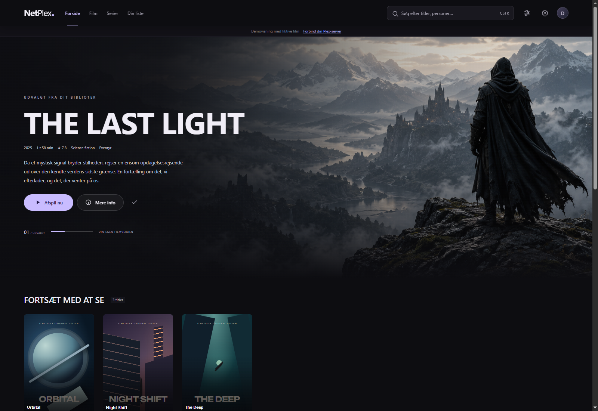
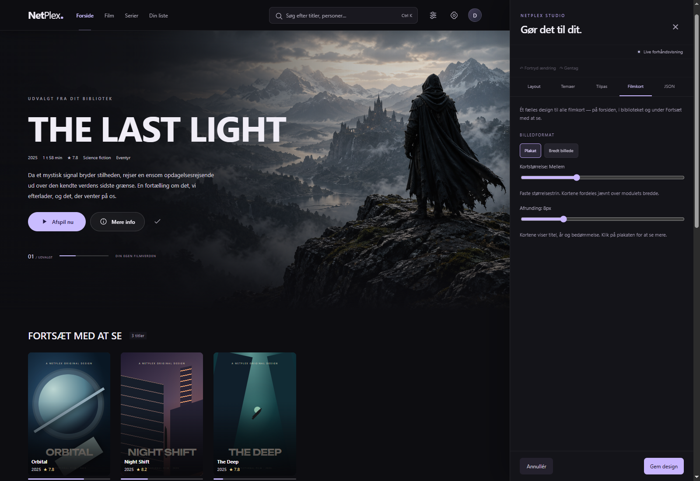
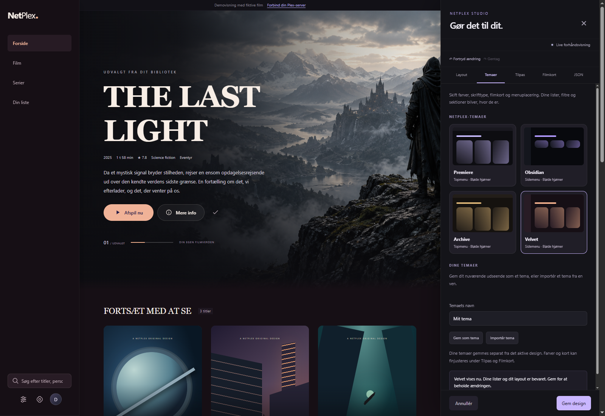

<p align="center">
  
</p>

<h1 align="center">NetPlex for Windows</h1>
<p align="center">Your Plex library. Your layout. Your own streaming experience.</p>
<p align="center">
  <a href="https://github.com/kensmark/netplex/releases/latest"><strong>Download the Windows installer</strong></a>
  · <a href="#features">Features</a>
  · <a href="#netplex-studio">NetPlex Studio</a>
  · <a href="#development">Development</a>
</p>



NetPlex is a customizable **Windows x64 desktop client for Plex Media Server**. Browse films and series from your connected servers, build your own home screen, and play original media with the bundled native player.

The interface currently uses Danish labels. Screenshots show the actual Windows app with fictional demo content; no personal library or Plex credentials are included.

## Install

1. Open the [latest release](https://github.com/kensmark/netplex/releases/latest).
2. Download **`NetPlex-Setup-1.4.1.exe`** under **Assets**.
3. Run the installer and open NetPlex from the desktop or Start menu.
4. Choose **Log ind med Plex**, complete the sign-in in your browser, and return to NetPlex.
5. Choose which Plex servers to include in your library.

The installer includes the player. **Node.js, a terminal, command files and a separate mpv installation are not required.** Your films remain on your Plex server; NetPlex does not include media or provide access to other libraries.

While this repository is private, downloads require GitHub access to the repository. The installer is currently unsigned, so Windows may display an unknown-publisher or SmartScreen prompt. Install newer versions over the existing app to keep your saved settings.

## Features

- **One library, multiple servers.** Include or exclude servers in Settings. Copies with matching global Plex, IMDb, TMDB or TVDB identifiers appear as one title. Details show its available servers and let you choose the playback source.
- **Native playback.** The bundled mpv player handles original MKV/HEVC media, audio tracks, and embedded or external subtitles locally. Compatible files can play without asking Plex to convert the video or burn in subtitles.
- **A home screen you control.** Reorder modules, add categories, combine genre, year, rating, actor and director filters, and choose a carousel, grid or vertical poster column for each category. Select a module to reveal its trash icon. Metadata pickers contain names from your own library.
- **Consistent film cards.** Choose posters or landscape artwork, seven size steps, and rounded corners. Title, year and rating stay inside the artwork. Hover or keyboard focus reveals the save icon; click the card for details.
- **Search and browse.** Type directly in the top search field, or press **Ctrl+K**. Search across films and series, or use the separate searches and filters inside Film and Serier.
- **Continue watching and your own list.** Resume playback, save titles, and mark them watched. Playback progress syncs to the selected Plex source. Saved lists belong to the current NetPlex installation and Plex account.
- **A quiet full-screen player.** Playback controls, title and track settings hide after inactivity and return with mouse movement. Use Space to pause, arrow keys to seek, F for full screen and M to mute.
- **Responsive desktop layout.** Rows adapt to the available width and keep their height while paging. The interface follows display scaling; layouts have been checked at simulated 3840 × 2160 with 100%, 150% and 200% scaling.

### The default home screen

New installations start with a featured film, Continue Watching, Recently Added films, a series row and saved titles. Empty modules stay hidden. Change the order or replace modules in **NetPlex Studio → Layout**.

## NetPlex Studio

Keep your categories while changing how NetPlex looks.



| Tab | What you can change |
| --- | --- |
| **Layout** | Home modules, order, category rules and library views. Category templates appear inside the selected category's settings. |
| **Temaer** | Four included themes and your own locally saved themes. |
| **Tilpas** | Colors, font and top or side navigation. |
| **Filmkort** | The shared card format, size and corner rounding. |
| **JSON** | Import/export a theme, a layout or a complete design backup. |

Changes preview immediately. **Gem design** saves; **Annullér** restores the saved design. A theme changes appearance while preserving your layout and category rules.



Share a `.theme.netplex.json` or `.layout.netplex.json` file with a friend, or give it to ChatGPT as a starting point for a new design. Design files are validated data rather than executable code and do not contain Plex login details. The recipient's own library supplies the films.

## Playback and privacy

NetPlex runs locally on your computer. Plex sign-in opens Plex's own authentication page. The local backend keeps server tokens away from the interface and native player. Settings, saved designs and personal themes live in `%APPDATA%/NetPlex Desktop` and are excluded from the repository and installer.

This is an independent Plex client. Normal Plex permissions, server availability and remote-access requirements still apply. Native playback currently uses **original quality**, so your connection and computer must handle the original bitrate and codecs. Multipart media is not yet supported as a continuous film. This version has no automatic updater; use the installer for updates.

## Development

The source in this repository builds the **Windows desktop app**. `src/` and `public/` provide its embedded interface; `server/` provides its local Plex engine. A separate hosted website is not part of this repository.

Use **Windows x64**, Git, and Node.js **24 LTS** (minimum 22.12).

```powershell
git clone https://github.com/kensmark/netplex.git
cd netplex
npm ci
npm --prefix desktop ci
npm run setup:desktop
npm start
```

If Electron installation scripts were disabled, run `node desktop/node_modules/electron/install.js` once. The pinned mpv download is checked against the SHA-256 in `desktop/player-release.json`.

Build the standalone application and installer:

```powershell
npm run build:windows
```

Outputs:

- `Windows/NetPlex-win32-x64/NetPlex.exe` — keep its whole folder together.
- `Windows/Installers/NetPlex-Setup-<version>.exe` — the single file to distribute.
- `Windows/Installers/SHA256.txt` — installer checksum.

Run checks:

```powershell
npm run check
npm test
npm run test:desktop
npm run test:ui
```

UI tests start isolated Windows app instances with fake Plex servers. They do not need your personal Plex account.

| Directory | Purpose |
| --- | --- |
| `desktop/` | Electron host, native video surface, mpv integration and Windows packaging. |
| `src/` | TypeScript/React interface, Studio and design contracts. |
| `public/` | Embedded interface assets and host integration. |
| `server/` | Local Plex connection, catalog, streaming proxy and design persistence. |
| `designs/` | Included design presets. |
| `tests/`, `desktop/tests/` | Backend, design and native-player tests. |

See [the design architecture](docs/DESIGN-ARCHITECTURE.md), [Windows development notes](desktop/README.md), and [agent instructions](AGENTS.md). Third-party licenses and source references are listed in [desktop/THIRD-PARTY.md](desktop/THIRD-PARTY.md); original demo artwork is described in [ASSETS.md](ASSETS.md).
